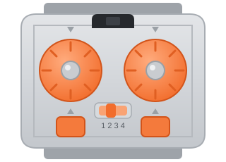
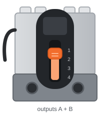
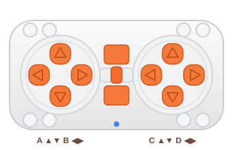
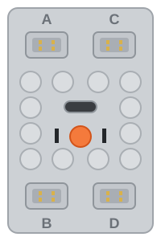

# nanoBrick

**Control AliExpress building-block motors and trains from an ESP32 + nRF24L01+, in C# (.NET nanoFramework).**
Reverse-engineered 2.4 GHz remote protocols, a Bluetooth text API, a Windows remote app, and a sniffer
to decode your own remotes.

Drive cheap **Power Functions–style motors** (the AliExpress clones: USB-C battery box, 1–4 selector
receivers, M / L / XL motors, servos) **from an ESP32 + nRF24L01+, without any rewiring**, by imitating
their original 2.4 GHz remotes. The firmware is written in **C# with [.NET nanoFramework](https://www.nanoframework.net/)**
and takes simple text commands over Bluetooth, so it can be driven from a PC app today and from
**Scratch** tomorrow (the project was started so that kids can program their own trains).

> Not affiliated with, endorsed or sponsored by the LEGO Group. "Power Functions" is only used to
> describe the type of compatible hardware.

## What works

| System | Original remote | Control | Status |
|---|---|---|---|
| Receiver with a 1–4 selector, 2 outputs (A/B) | grey remote with 2 wheels (PCB `JM039TX`) | speed by steps (~20–25 steps = full speed), stop | ✅ up to 4 receivers = 8 motors |
| Battery box with 4 outputs (A–D) | white remote with 8 arrow buttons (PCB `AW2101048`) | on / off, both directions, full speed only | ✅ |

Both protocols were reverse-engineered with the sniffer in [`tools/Sniffer`](tools/Sniffer) and are
documented in [`docs/`](docs).

### Is my hardware compatible?

These parts are sold under many names on AliExpress, Amazon, Temu… as "building blocks motor",
"technic motor", "power functions compatible", "remote control train" or "2.4G receiver" kits.
Each remote goes with its own receiver. Find yours (drawings, not photos):

| Grey remote → selector receiver | White remote → 4-output battery box |
|:---:|:---:|
|   |   |
| Two orange **thumb wheels** with notches, two orange **stop** buttons, a **1–4 selector**. PCB marked **`JM039TX`**. | Two orange **arrow pads** (A▲▼ B◀▶ on the left, C▲▼ D◀▶ on the right), two square buttons. PCB marked **`AW2101048`**. |
| Receiver block with the **same 1–4 selector on its front** and two outputs (A, B). Up to 4 receivers, one per selector position. | Grey USB-C **battery box** with an orange button and **4 outputs A–D**; the receiver is built in. Pairs with the first remote it hears. |
| Speed by steps, kept by the receiver. → [protocol](docs/protocol-jm039.md) | On / off, both directions, full speed. → [protocol](docs/protocol-battery-box.md) |

Other grey thumb-wheel clones very likely use the same protocol (same look, same receiver); tell us if
yours works.

> **Not compatible:** the original LEGO® Power Functions remotes and receivers (8879, 8885, 8884) look
> similar but use **infrared**, not 2.4 GHz radio. nanoBrick only speaks the radio protocols of the clones.

- Something else? The [sniffer](tools/Sniffer) finds the channels and dumps the frames of most 2.4 GHz
  toy remotes (nRF24L01 and XN297-based chips, "promiscuous" mode included). Contributions welcome!
- Genuine **Mould King** boxes are not supported yet; see [the notes](docs/mouldking-notes.md).

### Why?

The original remotes are fine for playing, but not for **programming**. With nanoBrick, a PC, a phone or
(soon) **Scratch** can drive several motors at once: model trains, cranes, gates, robots — a cheap way to
teach kids coding with the bricks they already have.

## Hardware

- ESP32 DevKit (38 pins, tested with an ESP32-32U)
- nRF24L01+ PA+LNA module on its 5 V adapter board
- Wiring: see [docs/wiring.md](docs/wiring.md). A 3D-printable case is planned in [`hardware/`](hardware).

## Firmware architecture

```
src/NanoBrick/
├─ Program.cs                  Bluetooth LE (Nordic UART) wiring, line splitting
├─ CommandInterpreter.cs       text command → transmitter calls
├─ Protocols/                  pure frame encoders, unit-tested on the PC
│  ├─ Jm039Protocol.cs         grey remote (nRF24, custom CRC)
│  └─ BatteryBoxProtocol.cs    white remote (XN297 whitening + CRC)
├─ Transmission/
│  ├─ Transmitter.cs           8 ms transmission loop on its own thread, frame cache
│  ├─ ReceiverLink.cs          when to talk / stay silent for one receiver (lock-in, keep-alive)
│  └─ MotorQueue.cs            allocation-free job queue per motor
└─ Hardware/Nrf24Radio.cs      minimal transmit-only nRF24L01+ driver
```

The protocol and scheduling classes have no hardware dependency: the test project compiles the very same
source files for .NET 10 and checks them against frames captured from the real remotes.

## Repository layout

```
docs/       protocols, wiring, notes
src/        C#: NanoBrick (ESP32 firmware, nanoFramework), NanoBrick.Tests (xUnit tests with real frames),
            Remote (Windows WPF remote control, Bluetooth or USB)
tools/      Sniffer (Arduino nRF24 sniffer used to decode the remotes)
            JM039TX (Arduino transmitter + Web Serial page: alternative to the C# firmware, not maintained)
hardware/   3D-printed case (to come)
```

## Quick start (C#)

Replace `COM5` with the serial port of your ESP32.

1. Flash the nanoFramework firmware: `nanoff --target ESP32_BLE_REV0 --serialport COM5 --update --masserase`
2. Open `src/NanoBrick.sln` in Visual Studio (nanoFramework extension) and deploy `NanoBrick`,
   or from the command line:
   `nanoff --nanodevice --serialport COM5 --deploy --image src\NanoBrick\bin\Release\NanoBrick.bin`
   then press the **EN** button.
3. Run `src/Remote` (`dotnet run --project src/Remote`), choose **Bluetooth « NanoBrick »**, connect.
4. PC tests (protocols checked against real captured frames, scheduling): `dotnet test src/NanoBrick.Tests`

## Commands (one text line each, over Bluetooth)

| Command | Meaning |
|---|---|
| `[1-4]a+ [n]`, `a-`, `b+`, `b-` | n steps on output A or B of receiver 1–4 (default: current receiver) |
| `[1-4]sa [n]`, `sb` | stop output A / B (orange button held n × 100 ms) |
| `x` | stop everything |
| `k 1` / `k 0` | keep receivers "locked" (light steady) |
| `m 1234` | receivers that are present (keep this to the ones you really have) |
| `ha+ [n]` … `hd- [n]` | battery box: output A–D in one direction for n × 100 ms |
| `hx [a-d]` | battery box: stop one output, or all |
| `p 0-3` | radio power (keep 0 = −18 dBm: louder saturates the receivers) |
| `f` | status |

## Known limitations

- The C# firmware gets overloaded when the 4 receivers are kept locked at the same time
  (some Bluetooth commands get lost): declare only the receivers you have (`m`).
- Bluetooth reconnections can be slow; pressing **EN** on the ESP32 helps.

## License

GPL-3.0 — the XN297 emulation is derived from
[DIY-Multiprotocol-TX-Module](https://github.com/pascallanger/DIY-Multiprotocol-TX-Module) (GPLv3).
