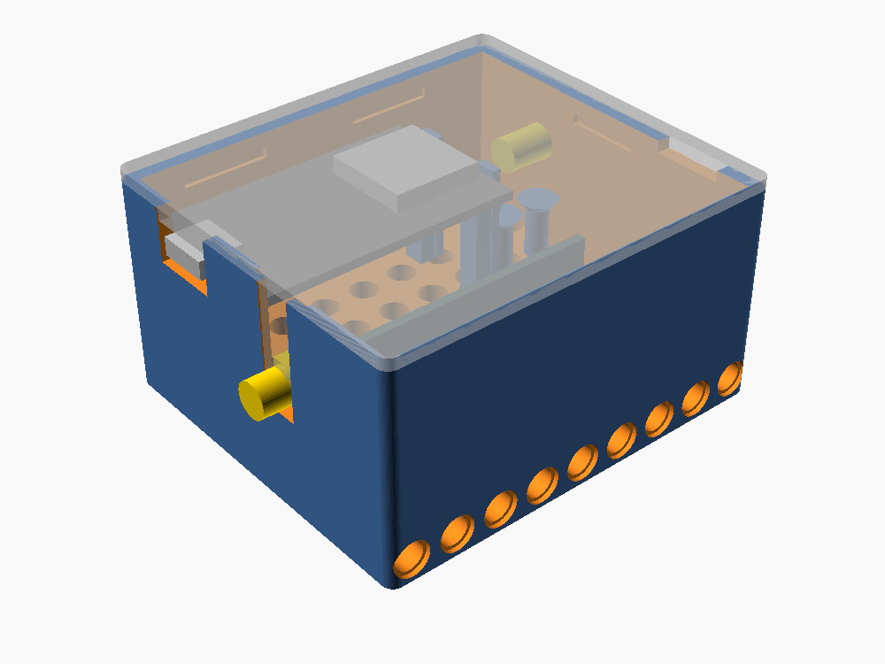
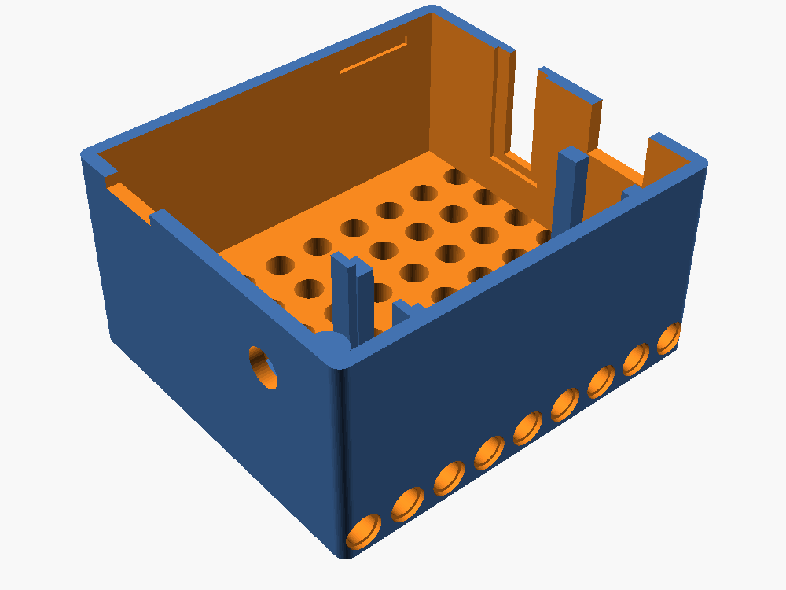
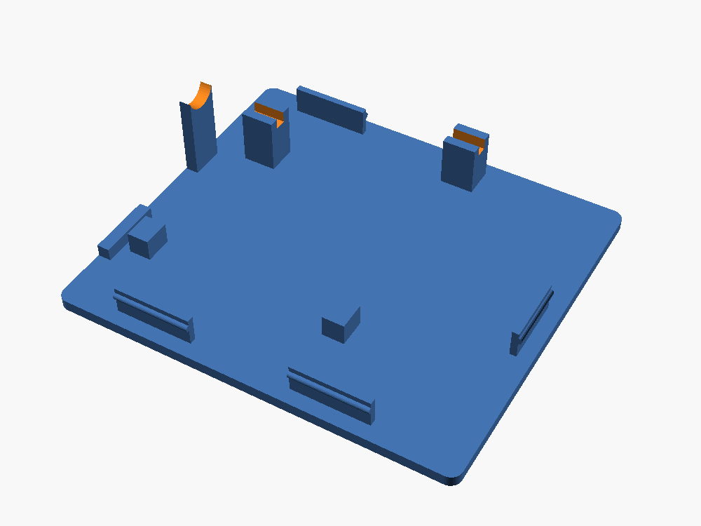
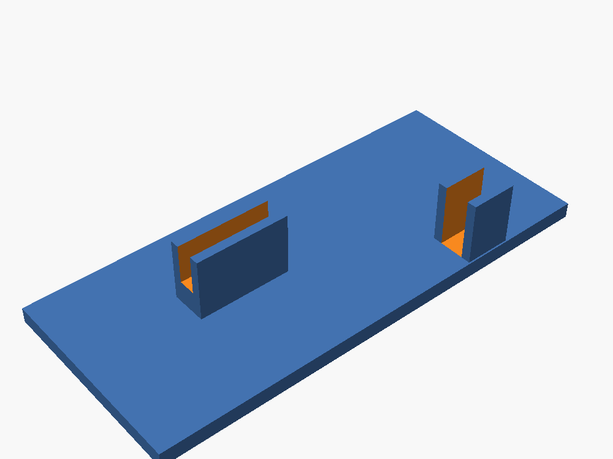

# 3D-printed transmitter case

A case for the ESP32 + nRF24 transmitter. It sits on LEGO Technic parts, holds both antennas at the ends, and has a clip-on lid.
The parts are parametric OpenSCAD files, with every dimension at the top of [transmitter_case.scad](transmitter_case.scad).
Ready-to-print STL files are in [stl/](stl/).



Built for an **ESP32 DevKit, 38 pins, ESP32-32U module** (USB-C, u.FL Wi-Fi antenna on a pigtail with a bulkhead connector),
and an **nRF24L01+ PA+LNA** module on its 5 V adapter board (soldered right-angle SMA connector).

## 1. First: the calibration part

[calibration.stl](stl/calibration.stl), about 25 minutes. It tests 5 round holes (for pins) and 5 cross holes (for axles):
1 = 4.7 mm, 2 = 4.8, 3 = 4.9, 4 = 5.0, 5 = 5.1. Pick the one that grips like real LEGO and put its value in
[technic.scad](technic.scad) (`pin_hole_d`, `axle_w`). It is set to 5.0 mm (hole 4, PETG on a Creality K2).
Print it again if you change filament.

## 2. The parts

| Part | STL | What it does |
|---|---|---|
|  | [transmitter_case.stl](stl/transmitter_case.stl) | The floor is a 9 × 8 Technic plate, and each long side has a row of 9 horizontal holes, so the case can lie flat or stand against a build. End 1: USB-C opening and a U slot for the SMA elbow. End 2: hole for the Wi-Fi bulkhead connector and a fingernail notch. Inside: four pillars for the ESP32 and two posts to wind the spare pigtail |
|  | [transmitter_lid.stl](stl/transmitter_lid.stl) | Clips on (four tabs, no screws). Tongues close the SMA slot and the top of the USB opening. Pressers hold the ESP32 and the nRF boards down |
|  | [nrf_cradle.stl](stl/nrf_cradle.stl) | Holds the nRF adapter and module standing on their edge, in the corner of the case. Small and quick to reprint if the boards do not fit |

Outside size: about 72 × 64 × 39 mm.

## 3. Assembly

1. Put the cradle in the corner at end 1, on the nRF side.
2. Drop the nRF stack into the cradle, with the SMA elbow in the U slot.
3. Drop the ESP32 on its pillars, components up, with its USB-C socket in the opening.
   Fold the Dupont wires under the board.
4. Put the Wi-Fi bulkhead connector through the hole at end 2 and tighten its nut. Wind the spare pigtail around the two posts
   so that it never pulls on the u.FL connector.
5. Clip the lid on, then screw both antennas on and fold them upright.
   **Always screw the nRF antenna on before powering the board.**

To restart the ESP32, unplug and plug the USB cable back in. Open the lid (fingernail notch) if you need the BOOT or EN buttons.

## 4. Print settings

- **PETG** (sturdier than PLA for drops and for the antenna lever, and its clips bend instead of breaking).
  Never use metal-filled, carbon or "conductive" filament near antennas.
- 0.2 mm layers, **3 walls**, 20 % infill, no supports, no brim.
- Case standing on its floor, lid outer face down (the STL is already flipped), cradle on its base.
- On a Creality K2: about 2 h 20 for the case, 15 minutes for the cradle.

## 5. Other boards

The files were tested with the boards listed at the top. If yours differ, check the dimensions at the top of
[transmitter_case.scad](transmitter_case.scad), print the cradle first (it is quick) to check the nRF stack,
then run:

```powershell
powershell -ExecutionPolicy Bypass -File .\export.ps1
```
